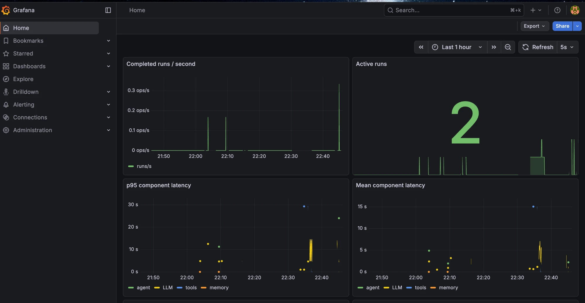
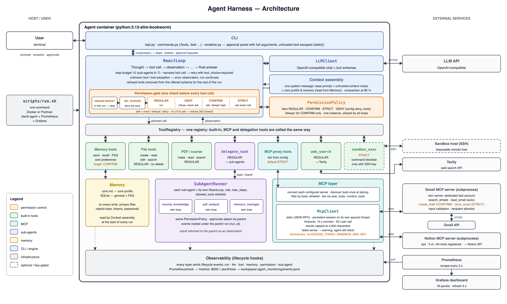
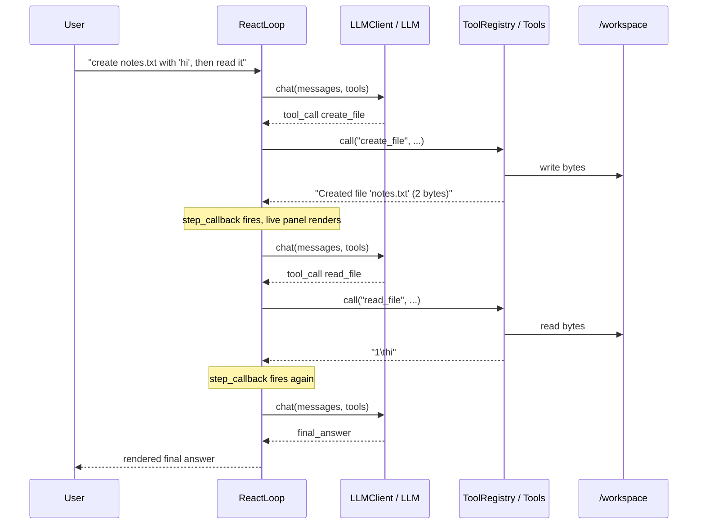

# Agent Harness

A terminal-based AI agent harness in Python: a ReAct loop over any
OpenAI-compatible model, a tool registry (workspace files, web search, Gmail and
Notion over MCP), long-term memory, sub-agents, approval prompts for risky
tools, remote command execution over SSH, and Prometheus/Grafana monitoring.

> Built as a team project (three students) for the AI Engineering course in my
> master's program at the University of Passau (final grade 1.3 on the German
> scale, where 1.0 is the best). It was developed and tested against a
> vLLM-served Qwen model; any OpenAI-compatible endpoint works.

## Contents

- [Features](#features)
- [Architecture](#architecture)
- [Quick start](#quick-start)
- [Integrations](#integrations)
- [Configuration](#configuration)
- [Security model](#security-model)
- [Tests](#tests)

## Features

- **ReAct loop** with step limits, narrated-call detection, and context
  compaction (older turns are summarized once the context window fills).
- **Tools**: workspace file tools (create, read, edit, list, search, with
  `dry_run` diff previews) that stay inside the workspace and cannot delete;
  `web_search` (Tavily); PDF reading and search; course-material indexing.
- **MCP**: Gmail and Notion servers, tools discovered at startup; third-party
  tools default to the strictest approval tier.
- **Long-term memory**: SQLite store with FTS5 search and retention scoring, a
  bounded core profile (`core.md`), and a privacy filter that rejects keys,
  tokens and passwords.
- **Sub-agents**: `course_knowledge` (cited answers from PDFs, cached as FAQs),
  `pdf_analyst`, and `memory_manager`, each with its own loop, role, step limit
  and tool allow-list.
- **Permissions**: four tiers (`REGULAR`, `CONFIRM`, `STRICT`, `DENY`); the
  approval prompt shows the full tool arguments; fail-closed when nobody can
  be asked.
- **Remote execution**: `sandbox_exec` runs one command over SSH with a
  destructive-command blocklist; off unless a key is configured.
- **Monitoring**: lifecycle events to Prometheus (18-panel Grafana dashboard)
  and JSONL traces; fail-open, off by default.



## Architecture





Each tool call is a full round-trip to the model; `max_steps` caps runaway
loops. Folder structure, memory design, permission policy and the lifecycle
hooks are described in [docs/architecture.md](docs/architecture.md) and
[docs/monitoring.md](docs/monitoring.md).

## Quick start

**Needs:** Docker or Podman (Podman 4+), bash, and an API key for an
OpenAI-compatible endpoint.

```bash
git clone <repository-url> agent-harness && cd agent-harness
cp .env.example .env          # set ACCESS_TOKEN=<your API key> (and LLM_BASE_URL if not OpenAI)
./scripts/run.sh              # builds the image, starts monitoring, opens the agent prompt
```

The defaults in `config/default.yaml` (`model`, `context_window_tokens`) match
the Qwen model this was developed against: set them for your provider, and
`LLM_BASE_URL` for a non-OpenAI endpoint.

You land at `agent >`. Try:

```
Create a folder called output and inside it a file called numbers.md containing the numbers 1 to 5 written out in words.
```

Expected: `workspace/output/numbers.md` with "one" to "five" (the host's
`workspace/` is the agent's `/workspace`). `/help` lists the slash commands,
`/tools` the tools, `/exit` quits. Grafana is at <http://localhost:3000> (no
login to view; the admin password is `GRAFANA_ADMIN_PASSWORD` from `.env`, else
`admin`/`admin`). Both ports bind to `localhost` only. `./scripts/run.sh --stop`
stops the monitoring stack, `--clean` also deletes its data, `--no-monitoring`
skips it.

Without monitoring:

```bash
docker build -t agent-harness .
docker run --rm -it --env-file .env -v "$(pwd)/workspace:/workspace:z" agent-harness
```

**Check the setup** (reports each feature as OK / missing / disabled, never
prints a secret):

```bash
docker run --rm --env-file .env --entrypoint python agent-harness -m agent.doctor
python -m agent.doctor        # same, with a local Python 3.12 install
```

**Without a container** (Python 3.12): `pip install -e ".[gmail,sandbox]"`, then
run `python -m agent` from a scratch folder (the file tools work on the current
directory). The Notion server needs Node.js 18+ on the host; the image has it.

## Integrations

All optional; a missing one is simply off.

**Web search.** Set `TAVILY_API_KEY` (free key at <https://tavily.com>). Without
it `web_search` returns an error observation and nothing else changes.

**Gmail (MCP).** Use a dedicated test account, never a personal one: the tools
can read the whole mailbox and `send_email` really sends. `search_emails` and
`read_email` run without asking, `create_draft` asks once per session,
`send_email` asks every time. Setup:

1. In the Google Cloud console create a project, enable the Gmail API, set the
   OAuth consent screen to *testing* and add the account as a test user.
2. Create an OAuth client of type *Desktop app* and save its JSON as
   `.secrets/gmail/credentials.json` (`.secrets/` is gitignored).
3. Authorize it (opens a browser; scopes are `gmail.readonly` and
   `gmail.compose`, so no delete):

   ```bash
   GMAIL_CREDENTIALS_PATH="$PWD/.secrets/gmail/credentials.json" \
   GMAIL_TOKEN_PATH="$PWD/.secrets/gmail/gmail-token.json" \
   python -m agent.mcp_servers.gmail_auth
   ```

4. Optionally restrict recipients with `GMAIL_ALLOWED_RECIPIENTS` in `.env`.

`./scripts/run.sh` mounts `.secrets/gmail/` at `/gmail` when both files exist.
Refresh tokens of an app in testing mode expire after 7 days; repeat step 3.

**Notion (MCP).** Create an internal integration at
<https://www.notion.so/my-integrations>, share a scratch page or database with
it, and set `NOTION_TOKEN` in `.env`. Only five of the server's tools are
registered; search, retrieve and query run without asking, and page
creation/update ask once per session.

**Remote execution (`sandbox_exec`).** Set the `sandbox:` block in
`config/default.yaml` (host, user, port) to a throwaway SSH-reachable machine
and put a passphrase-less Ed25519/ECDSA/RSA key in `.env` as base64:

```bash
echo "SANDBOX_SSH_KEY=$(base64 < sandbox_key | tr -d '\n')" >> .env
```

Every call asks for approval (`STRICT`, no "always"), and destructive-looking
commands (`rm`, `dd`, `mkfs`, `truncate`, `git push --force`, ...) are refused
before anything is sent. The blocklist is a guardrail against mistakes, not a
security boundary.

## Configuration

Non-secret settings are in `config/default.yaml` (another file via
`AGENT_CONFIG_PATH`, or `CONFIG_SOURCE=` for `./scripts/run.sh`). Secrets come
only from the environment: the loader rejects an `access_token`, or a sandbox
`password`/`private_key`, in the file.

| Key | What it controls |
|---|---|
| `model`, `temperature`, `max_tokens`, `timeout`, `base_url` | LLM provider settings |
| `context_window_tokens`, `compaction_*` | Long-conversation compaction thresholds |
| `monitoring` | Prometheus / JSONL observability |
| `mcp_servers` | MCP servers, which of their tools are registered, their approval tier (`auto_tools`, `confirm_tools`; anything else asks every time), and the variables each may see (`env`) |
| `permissions` | `deny_tools`: tools blocked outright, never run and never asked about |
| `sandbox` | Remote host for `sandbox_exec`; inactive without `SANDBOX_SSH_KEY` |
| `courses` | PDFs indexed for `course_knowledge` (put them under `resources/courses/<id>/materials/`) |
| `subagents` | Sub-agent roles, allowed tools and step limits |

Environment variables (put them in `.env`):

| Variable | Purpose |
|---|---|
| `ACCESS_TOKEN` | API key for the LLM endpoint. `LLM_API_KEY` and `OPENAI_API_KEY` work too; if several are set, `LLM_API_KEY` wins, then `OPENAI_API_KEY`, then `ACCESS_TOKEN` |
| `LLM_BASE_URL` / `OPENAI_BASE_URL` | Endpoint of an OpenAI-compatible API (a `base_url` in the config file wins; default `https://api.openai.com/v1`) |
| `TAVILY_API_KEY` | Enables `web_search` |
| `NOTION_TOKEN` | Enables the Notion MCP server |
| `GMAIL_ALLOWED_RECIPIENTS` | Recipient allowlist for `send_email` / `create_draft` (addresses and/or `@domain`) |
| `GMAIL_CREDENTIALS_PATH`, `GMAIL_TOKEN_PATH` | Gmail OAuth files; set only when running on the host, the container reads `/gmail/...` |
| `SANDBOX_SSH_KEY` | Private key content (base64 or PEM text, never a path) for `sandbox_exec` |
| `AGENT_CONFIG_PATH` | Which config file to load |
| `CONTAINER_ENGINE`, `AGENT_IMAGE`, `CONFIG_SOURCE`, `GMAIL_DIR`, `PROMETHEUS_PORT`, `GRAFANA_PORT`, `GRAFANA_ADMIN_PASSWORD` | `scripts/run.sh` options |

A line `NAME=` in `.env` sets `NAME` to an empty string, which is not the same as
unset: comment out lines you don't use, and write `NAME=value` with no quotes.

## Security model

- **Nothing deletes files.** No tool removes files or folders; file tools are
  confined to the workspace root and refuse paths outside it.
- **Approval tiers.** `REGULAR` runs silently, `CONFIRM` asks once per session,
  `STRICT` asks on every call, `permissions.deny_tools` blocks a tool outright.
  With no way to ask, anything above `REGULAR` is refused, never run.
- **Third-party tools start at `STRICT`.** An MCP tool is only lighter when the
  config lists it under `auto_tools` or `confirm_tools`.
- **Tool output is untrusted.** Every agent prompt says so, and the approval
  panel escapes control characters and markup so it shows what will execute.
  Prompt injection through an email, web page or document cannot be ruled out;
  the approval prompt is the backstop.
- **MCP servers get a minimal environment** and never see `ACCESS_TOKEN` or
  `SANDBOX_SSH_KEY`.
- **Remote execution is not fully isolated.** The host's SSH key is not
  verified, the command runs with the sandbox user's full rights, and its
  output is returned uncapped.
- **Data leaves the machine** only for the model (prompts and tool results),
  Tavily, Gmail, Notion and the sandbox host. File access and memory stay local.
- **Monitoring** listens on `127.0.0.1` only.

## Tests

```bash
pytest                              # Python 3.12 and ".[gmail,sandbox]" installed
# or, with only Docker:
docker run --rm -v "$PWD:/src:ro" python:3.12-slim-bookworm bash -c \
  'cp -r /src /app && cd /app && rm -f .env && pip install -q ".[gmail,sandbox]" pytest pytest-cov && pytest -q'
./scripts/docker_e2e_test.sh        # image build, boot, and a live-model task if ACCESS_TOKEN is exported
```

The suite is unit tests plus end-to-end tests with a scripted model (real MCP
subprocess, real SQLite, real files). It contacts no external service, except
that a real token in `.env` together with configured Gmail credentials switches
on one live-model test.
