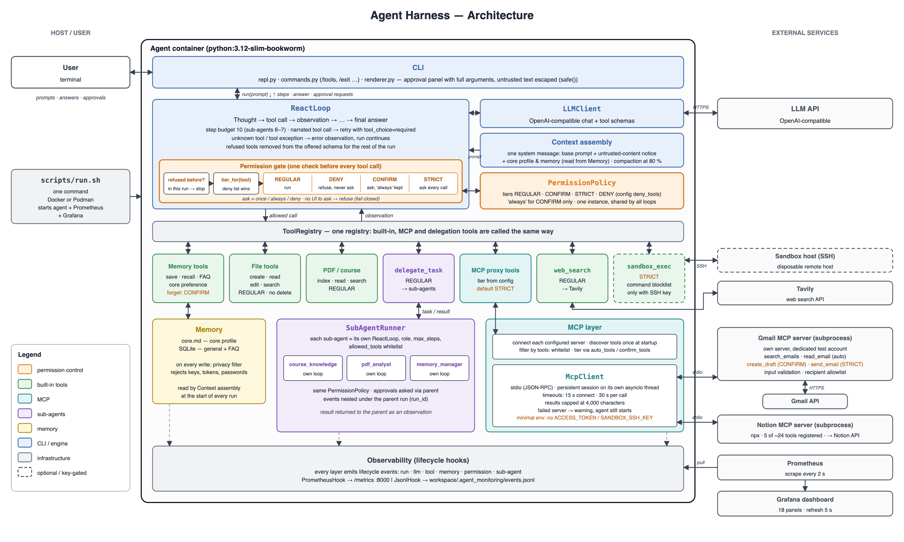

# Agent Harness architecture

This document distinguishes implemented runtime behavior from configuration
that is available only when enabled.

## Runtime composition



`src/agent/__main__.py:main` is the composition root for `python -m agent`.
It loads `AgentConfig`, creates the persistent-memory stores, registers tools,
connects configured MCP servers, creates `LLMClient` and `ReactLoop`, and starts
the CLI through `ReactEngineAdapter`.

```text
CLI -> ReactEngineAdapter -> ReactLoop -> LLMClient
                                  |
                                  +-> ToolRegistry -> built-in tools
                                  |                 -> MCP proxy tools -> MCP servers
                                  |                 -> delegate_task -> sub-agent loops
                                  |
                                  +-> system-prompt provider -> core profile
```

The CLI implementation is in `src/agent/cli_interface/`; the adapter in
`src/agent/orchestrator.py` keeps that interface separate from the loop's
string-returning `ReactLoop.run` API. `ToolRegistry.call` dispatches a
tool's `run` method; it does not validate arguments against the schema, so a
malformed call (an unknown tool, a missing or misnamed argument) comes back to
the model as an `Error: ...` observation it can correct, and `max_steps` still
bounds a model that keeps getting it wrong. The MCP client lives in
`src/agent/tools/mcp/`: `register_mcp_tools` starts configured stdio clients,
discovers remote tools, and registers `McpToolProxy` instances. Standalone MCP
servers remain outside the harness process. The Gmail server is
`src/agent/mcp_servers/gmail.py`; it uses OAuth/service construction from
`gmail_auth.py` and the Gmail API only when its tools are called.

## Current folder structure

```text
agent-harness/
+-- config/
|   +-- default.yaml                 # normal agent configuration; monitoring disabled
|   +-- prometheus/prometheus.yml    # scrape configuration
|   +-- grafana/                     # datasource and dashboard provisioning
+-- scripts/run.sh                   # one command: agent (foreground) + Prometheus + Grafana, Docker or Podman
+-- Dockerfile
+-- src/agent/
|   +-- __main__.py                  # startup, dependency construction, cleanup
|   +-- engine/
|   |   +-- llm_client.py            # provider calls, token/context tracking
|   |   +-- react_loop.py            # ReAct control flow and compaction
|   +-- observability.py             # events, contexts, hooks, fail-open delivery
|   +-- doctor.py                    # setup check: python -m agent.doctor (never prints secrets)
|   +-- monitoring/                  # Prometheus, JSONL, runtime lifecycle
|   +-- memory/
|   |   +-- sqlite_store.py          # general-memory and FAQ facade
|   |   +-- general_store.py         # SQLite general-memory repository
|   |   +-- faq_store.py             # SQLite FAQ repository
|   |   +-- core_profile.py          # bounded, atomic core.md profile
|   |   +-- routing.py               # deterministic memory-mutation routing
|   |   +-- tools.py                 # memory-manager tools
|   +-- subagents/                   # configs, runner, delegate_task tool
|   +-- tools/
|   |   +-- builtin/                 # internal filesystem/web tools
|   |   +-- mcp/                     # stdio client, proxy, registration
|   |   +-- pdf/                     # PDF and course-material indexing/search tools
|   |   +-- sandbox/                 # sandbox_exec: SSH remote command execution
|   +-- mcp_servers/                 # standalone Gmail MCP implementation
+-- tests/
```

## Persistent memory and routing

At startup, `main` creates:

- `SqliteMemoryStore` at `.agent_memory/memory.db` for searchable general
  memories and cached FAQ answers.
- `CoreProfileManager` at `.agent_memory/core.md` for a bounded set of stable
  user preferences. Its writes use atomic replacement.

General-memory records support FTS5 search, contradiction/upsert behavior,
retention scoring, and lifecycle pruning. FAQ entries have source metadata,
confidence handling, deduplication, and search. Core-profile values are
validated against an allowed-key list and privacy checks. During startup,
permitted core keys found in SQLite are migrated to `core.md` and removed from
SQLite, leaving one source of truth.

`route_memory_mutation` sends memory-write requests to the `memory_manager`
sub-agent. Its configuration requires a successful tool call before a final
success response. The parent registry excludes memory mutation tools; the
sub-agent's filtered registry includes only tools permitted by its configuration.

## Context window, course-material indexing, and sub-agents

`LLMClient` tracks provider-reported prompt tokens when available.
`ReactLoop` checks the resulting context-window percentage before the next
model call. When the configured threshold is reached and enough history exists,
it requests a summary of older turns while retaining the configured recent user
turns. If the provider raises `ContextWindowExceededError`, it uses emergency
compaction that retains the system message and current task, then retries. A
failed compaction callback does not stop the loop.

At startup, `PdfKnowledgeIndexer` indexes the PDFs listed under `courses:` in the
config (when the files exist) into `resources/courses/<course-id>/index.db`; unchanged PDFs are skipped through a
content hash. `SubAgentRunner` creates a filtered registry and isolated
`ReactLoop` for each configured role. `config/default.yaml` defines the
`course_knowledge`, `pdf_analyst`, and `memory_manager` roles.

Sub-agent loops receive the shared monitoring hook and preserve parent-run
correlation when delegated through `DelegateTaskTool`. Permission decisions in
those loops use the same confirmation callback as the parent.

## Permission policy

Every tool has a tier: `REGULAR` (runs), `CONFIRM` (asks once; "always" is
remembered for the session) or `STRICT` (asks on every call). First-party tools
declare theirs in code; MCP tools default to `STRICT` and are loosened only by
a server's `auto_tools` / `confirm_tools`. On top of that,
`permissions.deny_tools` in the config names tools (built-in or MCP) that are
blocked outright: they never run and nobody is asked, whatever tier the tool
declares. Together that gives the three outcomes: allow (`REGULAR`), require
confirmation (`CONFIRM`/`STRICT`) and deny (`deny_tools`, or the user
answering no).

One `PermissionPolicy` is created in `__main__` and handed to the parent loop
and to every sub-agent loop, so a deny entry and a user's "always" mean the
same thing wherever the call comes from. The gate is fail-closed: a tool that
needs confirmation when there is no way to ask (tests, embedding) is refused,
not run. Each decision is a `permission.request` lifecycle event whose
`decision` is `once` / `always` / `cached` / `deny` for a user's answer and
`policy_deny` when the policy (or a missing prompt) refused the call, so
policy denials are visible in the dashboard's permission panel.

Tool arguments and results carry text from emails, web pages and other people.
The renderer shows all of it through `neutralize` / `safe`: control characters,
Unicode direction overrides and tag characters become visible `\uXXXX`
escapes and Rich markup is escaped, so the approval panel shows what will
actually execute and cannot be restyled, hidden or crashed by its own content.

## Lifecycle monitoring

Monitoring is disabled by default (`monitoring.enabled: false`). When on,
`main` creates a `MonitoringRuntime`, wraps its consumers (Prometheus,
JSONL) in one `CompositeHook`, and injects that hook into the SQLite
store, core-profile manager, both tool registries, `LLMClient`, and the
parent `ReactLoop` — sub-agent loops get the same hook, with `RunContext`
threaded through `delegate_task` so their events nest under the parent
run rather than forming a disconnected trace.

Full reference — event schema, Prometheus metrics, the Grafana dashboard,
JSONL logs, and how to run the local Compose stack — is in
[docs/monitoring.md](monitoring.md).

## Design constraints

- `__main__.py` is the concrete dependency-composition boundary; other modules
  accept dependencies through constructors for unit testing.
- Built-in tools remain confined to the workspace, and the repository contains
  no delete tool.
- `load_config` rejects an `access_token` stored in a config file; it is loaded
  from supported environment variables instead.
- Monitoring is optional and does not alter normal behavior when disabled.
